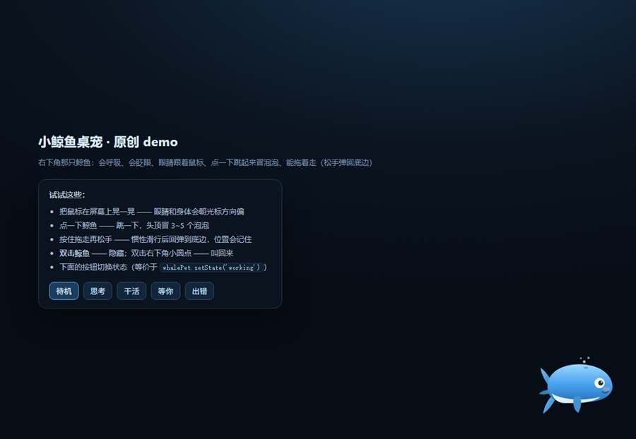
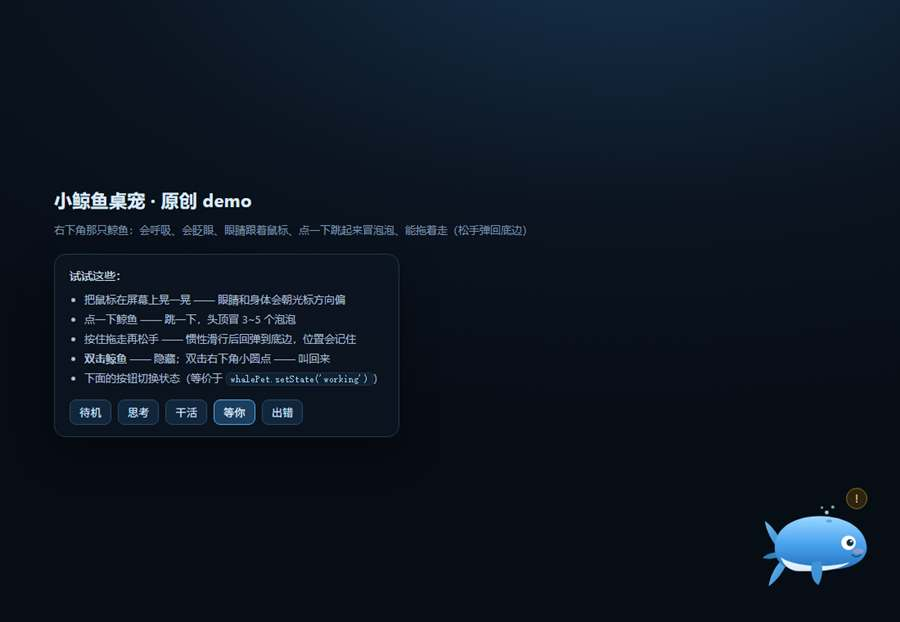

# 小鲸鱼桌宠（原创精简版）

一只住在屏幕右下角的小鲸鱼：会呼吸、会眨眼、眼睛跟着鼠标转、点一下跳起来冒泡泡、能拖着走。
**代码与素材 100% 原创**（内联 SVG + CSS + 原生 JS），不含任何第三方动画/图片，可商用（MIT）。



## 功能

| 能力 | 说明 |
| --- | --- |
| 呼吸浮动 | 3.4s 一次的轻微上下浮动（纯 transform，不用 filter，省 GPU） |
| 眨眼 | 每 3~6 秒随机眨一次 |
| 跟随视线 | 鼠标移动时，瞳孔朝光标方向偏移、身体轻微倾斜 |
| 点击回应 | 跳一下 + 头顶冒出 3~5 个泡泡 |
| 拖拽 | 按住可拖动，松手带惯性滑行并回弹到底边；位置记在 `localStorage` |
| 状态联动 | `whalePet.setState('idle'\|'thinking'\|'working'\|'waiting'\|'error')` |
| 隐藏 / 召回 | 双击鲸鱼隐藏，双击右下角小圆点召回 |

状态对应的头顶徽标：`thinking` 旋转圈、`working` 键盘、`waiting` 黄色感叹号、`error` 红色叉。




## 直接看 demo（不用装插件）

双击 `demo/index.html` 即可。页面底部有一排按钮可以切换五种状态。

## 作为 DSH 插件安装

1. 把整个文件夹放进 `<工作台>\插件\whale-pet\`（目录名随意，`package.json` 的 `name` 才是包名）。
2. 在 `<DSH_HOME>\profiles\web\cordis.patch.yml` 的 `insert:` 里加一条：

   ```yaml
   - insert:
       - id: whale-pet-host
         name: dsh-whale-pet-lite
   ```

3. 重启引擎（DSH 会重新解析 profile）。
4. 打开一次「设置」页（客户端入口挂在设置这个包上），鲸鱼就会常驻在右下角；
   之后即使关掉设置页它也不会消失。

> ⚠ 说明：DSH 客户端目前能稳定挂上的入口是设置页那个 client 包，
> 所以第一次需要"打开一次设置"来唤醒。如果以后官方提供全局 overlay 槽位，
> 只需把 `client/client.js` 里 `apply()` 的挂载方式换掉即可。

## API

```js
window.whalePet.setState('thinking');   // idle | thinking | working | waiting | error
window.whalePet.show();                 // 召回
window.whalePet.hide();                 // 隐藏
window.whalePet.destroy();              // 卸载
```

主机侧还留了一个状态接口（可选，给别的程序推状态用）：

```
GET  /plugins/whale-pet/state          → { ok, state, updatedAt }
POST /plugins/whale-pet/state          ← { "state": "working" }
```

## 结构

```
demo/index.html      demo 页面（双击即看）
demo/whale.js        桌宠本体（内联 SVG + 交互逻辑，约 12 KB）
demo/whale.css       样式与动画（约 6 KB）
lib/index.js         主机侧：静态资源路由 + 状态接口
client/client.js     客户端：把桌宠注入页面（不进 React 树）
cordis.patch.yml     挂载声明示例
```

## 许可

MIT © 2026 gegege-ai。见 [LICENSE](LICENSE)。
素材（SVG 图形、动画曲线、配色）均为本项目原创绘制，未使用任何第三方素材。
